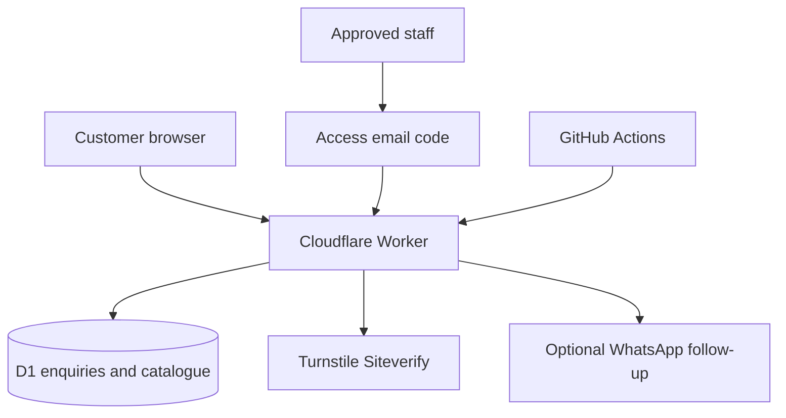

# Architecture and delivery plan

## Data and boundaries
Public catalogue reads reveal only published fields. Every administrative route is below /admin; the edge Access application covers that prefix and its descendants. Worker code additionally requires the configured Access audience and exact approved email through ctx.access. Alternate hostnames and direct Worker requests fail closed. POST/PATCH APIs require an exact same-origin Origin header. Turnstile validation requires the single-use token, expected action and exact current hostname before an enquiry write. D1 uses prepared statements and an idempotency unique key. Concurrent staff edits use version checks; successful updates and audit events are transactional.

Enquiry bodies contain personal data and are never logged. Database storage holds name, phone, requirements, timestamps, quote, assigned vehicle and notes. Admin catalogue text is escaped for HTML. Browser rendering uses textContent for customer fields. CSV export neutralizes common spreadsheet formula prefixes.

## Release boundaries
Implemented: enquiries, dynamic catalogue, content/status management, Access OTP, CI definitions, live health/readiness, scheduled retention. Pending owner setup: Actions deployment token, production inbox sign-in and real CAPTCHA exercise. Not implemented: instant inventory booking, payments, customer accounts, photo uploads, live driver tracking, SMS/email notifications or automated external uptime alerts. R2 and maps are intentionally not provisioned until needed.

## Next milestones
1. Upload owned fleet photos using an authenticated R2 upload flow; retain object allowlists and content-size checks.
2. Add date-range availability and transactional overlap protection only after real vehicle inventory and capacity rules exist.
3. Add approved tariff models (local hours/km, outstation daily minimums, extras) and revision history.
4. Separate staging D1 and Access audience before enabling automatic preview environments.
5. Complete restore exercise, documented incident simulation and measured SLO reports.

Do not present future milestones as live capabilities. GitHub commit history preserves the replaced placeholder scaffold.
